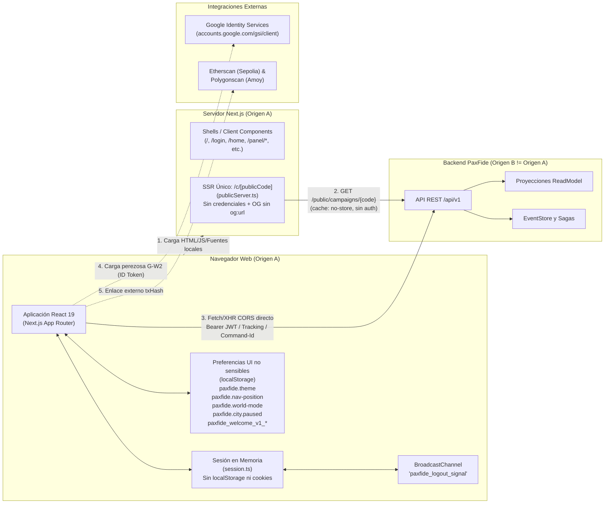
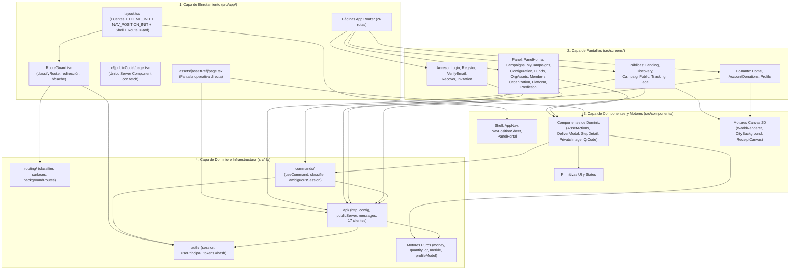
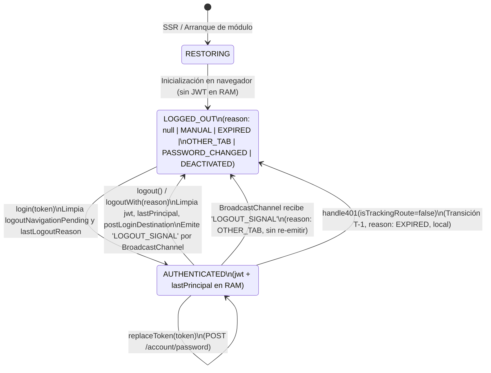
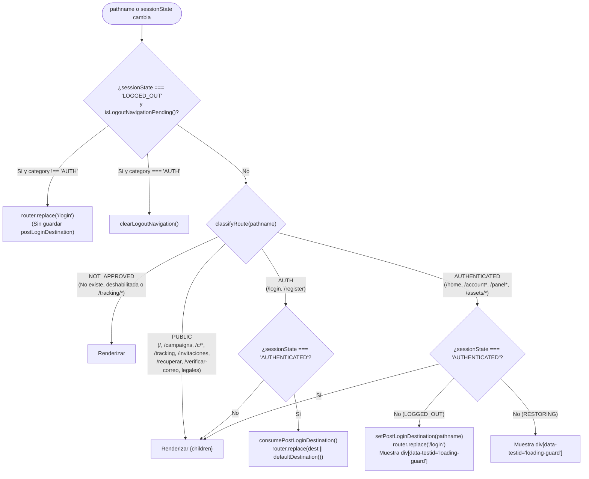
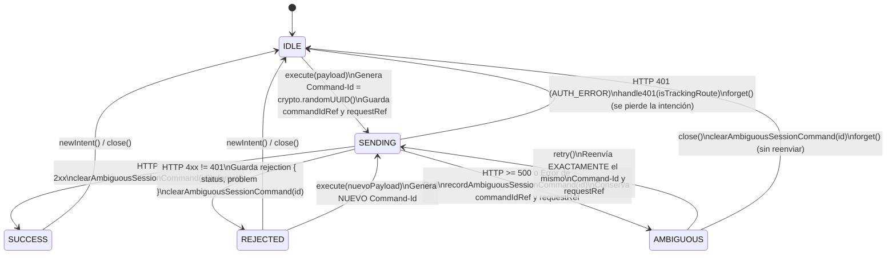
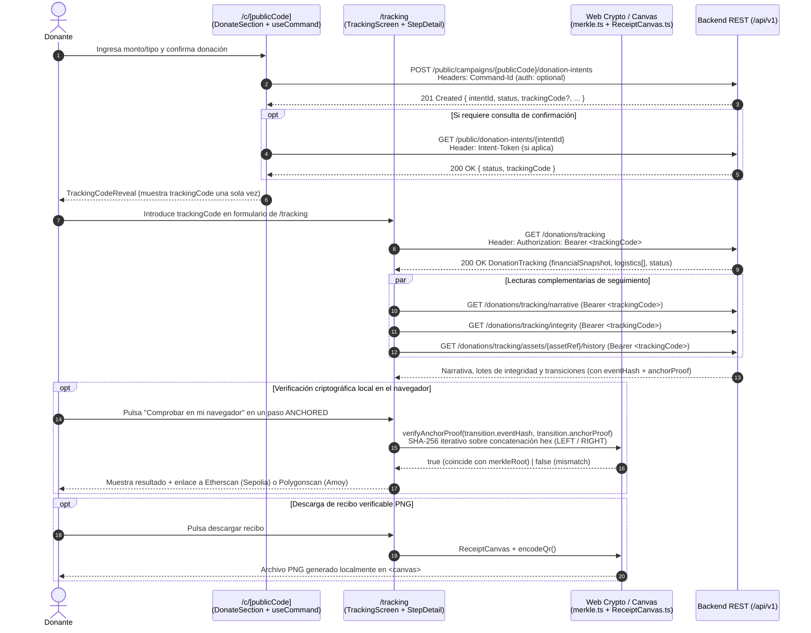
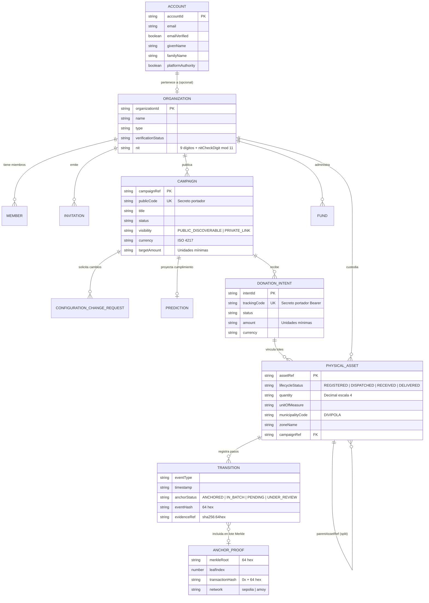

# 07. Diagramas Arquitectónicos y de Ejecución (`paxfide-web`)

> Todos los diagramas corresponden estrictamente a la implementación real verificada en `src/`.

---

## 1. Diagrama de Contexto y Frontera C1 (Sin BFF)

Refleja [`src/lib/api/config.ts`](../../src/lib/api/config.ts), [`src/lib/api/http.ts`](../../src/lib/api/http.ts), [`src/lib/api/publicServer.ts`](../../src/lib/api/publicServer.ts) y [`scripts/check-server-imports.js`](../../scripts/check-server-imports.js).



---

## 2. Arquitectura en Capas y Dependencias Internas



---

## 3. Máquina de Estados de Sesión JWT (`src/lib/auth/session.ts`)



---

## 4. Árbol de Decisión de `RouteGuard` (`src/app/RouteGuard.tsx`)



---

## 5. Máquina de Estados de Comandos Idempotentes (`src/lib/commands/useCommand.ts`)



---

## 6. Secuencia: Donación Pública, Seguimiento y Verificación Merkle

Refleja [`CampaignPublicScreen.tsx`](../../src/screens/CampaignPublicScreen.tsx), [`DonateSection.tsx`](../../src/components/campaign/DonateSection.tsx), [`TrackingScreen.tsx`](../../src/screens/TrackingScreen.tsx), [`StepDetail.tsx`](../../src/components/tracking/StepDetail.tsx) y [`src/lib/tracking/merkle.ts`](../../src/lib/tracking/merkle.ts).



---

## 7. Ciclo de Vida de Activos Físicos (`src/lib/api/assetClient.ts` y `assetCommands.ts`)

```mermaid
stateDiagram-v2
  [*] --> REGISTERED: POST /physical-assets/register\no POST /physical-assets/from-donation

  REGISTERED --> DISPATCHED: POST /physical-assets/{ref}/dispatch
  DISPATCHED --> RECEIVED: POST /physical-assets/{ref}/receive
  RECEIVED --> DISPATCHED: POST /physical-assets/{ref}/dispatch\n(Nuevo tramo en ruta)

  REGISTERED --> DELIVERED: POST /physical-assets/{ref}/deliver\n(Con evidenceRef previo de POST .../delivery-evidence)
  DISPATCHED --> DELIVERED: POST /physical-assets/{ref}/deliver
  RECEIVED --> DELIVERED: POST /physical-assets/{ref}/deliver

  REGISTERED --> REGISTERED: POST /physical-assets/{ref}/split\n(Crea sublote hijo; seguimiento vía\nGET /physical-assets/{ref}/splits/{childRef})
  RECEIVED --> RECEIVED: POST /physical-assets/{ref}/split

  DELIVERED --> [*]: Solo lectura (isReadOnly = true)
```

---

## 8. Modelo Entidad-Relación de Proyecciones y DTOs Consumidos


